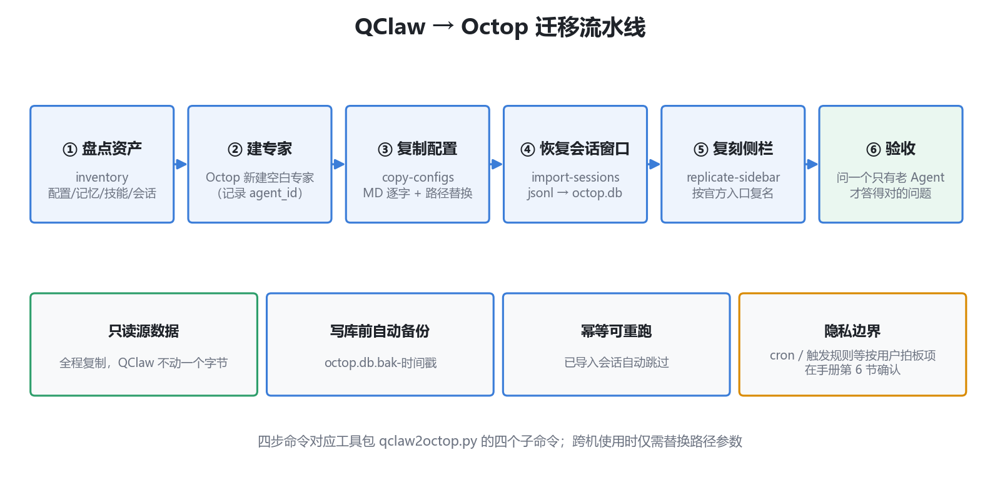

# qclaw2octop

把 QClaw 上的个人 Agent **完整迁移**到 Octop——人格配置、记忆、专属技能，以及**会话窗口级恢复**与侧栏入口复刻。

Migrate a personal agent from QClaw to Octop with full fidelity: persona configs, memory, custom skills, and conversation-window-level restoration with sidebar replication.



## 特性

- ✅ **逐字复刻人格配置**：SOUL / USER / IDENTITY / MEMORY / HEARTBEAT 同名 MD 文件原样迁移
- ✅ **会话窗口复活**：把 QClaw 的 jsonl 会话转换写入 Octop 数据库，历史对话以窗口形式重现
- ✅ **侧栏完全复刻**：按 QClaw `sessions.json` 的官方入口与命名还原会话列表
- ✅ **只读源数据**：全程复制，QClaw 侧不动一个字节
- ✅ **安全可重跑**：写库前自动备份，幂等设计，失败可随时回滚
- ✅ **跨机支持**：路径参数化，打包材料即可迁到另一台电脑
- ✅ **Agent 可用**：自带 SKILL.md，可作为技能被 Agent 直接加载执行

## 快速开始

```bash
# ① 盘点源 Agent 资产
python scripts/qclaw2octop.py inventory --qclaw-home ~/.qclaw --agent-id agent-xxxxxxxx

# ② 在 Octop 建空白专家（记录返回的 agent_id）

# ③ 复制配置 / 记忆 / 技能
python scripts/qclaw2octop.py copy-configs --package <迁移包> --workspace ~/.octop/agents/<agent_id> --path-map "旧路径=新路径"

# ④ 恢复会话窗口
python scripts/qclaw2octop.py import-sessions --db ~/.octop/octop.db --sessions-dir <jsonl目录> --agent-id <agent_id>

# ⑤ 复刻侧栏入口
python scripts/qclaw2octop.py replicate-sidebar --db ~/.octop/octop.db --sessions-json ~/.qclaw/agents/<源agent-id>/sessions/sessions.json --agent-id <agent_id>
```

## 作为 Agent 技能使用

把本仓库放入 Agent 的技能目录（`skills/qclaw2octop/`），Agent 即可按 `SKILL.md` 自主执行完整迁移流程。

## 文档

- 📖 [完整操作手册](references/migration-guide.md)——概念映射、决策清单、技术原理与限制、跨机指南、回滚方案、FAQ
- 🗺 [概念映射图](docs/concept-mapping.png)——QClaw 与 Octop 的概念对照

## 已知限制

恢复的历史会话窗口**能看、能续聊**，但模型上下文不自动延续（运行断点 checkpoint 不可迁移）。详见手册第 6 节。

## 要求

- Python 3.10+（零第三方依赖，仅标准库）
- Octop ≥ v1.0.2b7（会话恢复功能依赖其内部表结构）

## License

[MIT](LICENSE)
