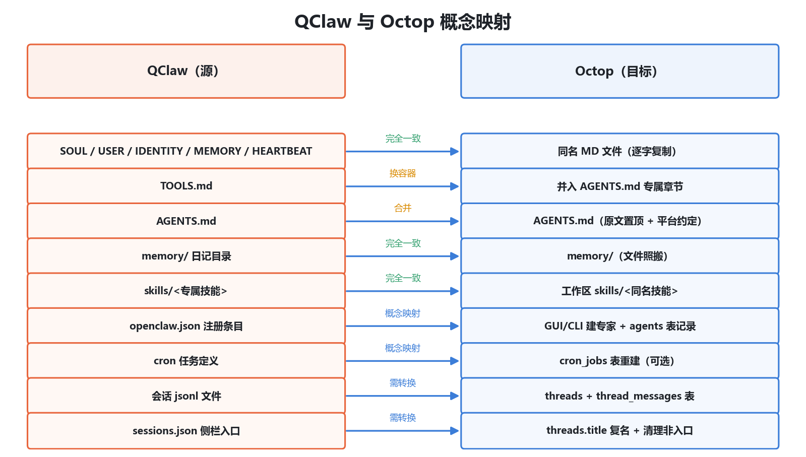

# QClaw → Octop 迁移操作手册

> 版本：v1.0（2026-10）
> 性质：通用执行手册。全部步骤已在真实环境跑通并验证。
> 配套工具：本仓库 `scripts/qclaw2octop.py`（单文件、零依赖、Python 3.10+）

---

## 1. 这本手册解决什么问题

把一个运行在 **QClaw** 上的个人 Agent 完整搬迁到 **Octop**，目标是**完全复刻**：

- 人格与配置（SOUL/USER/IDENTITY/MEMORY 等 Markdown 文件）
- 长期记忆与日记（memory/ 目录）
- 专属技能（skills/）
- **会话内容与侧栏会话窗口**（ jsonl → Octop 数据库，窗口级复活）
- 定时任务定义（cron，可选重建）

全程**只读源数据、复制式迁移**，QClaw 原有的一切不动一个字节。


---

## 2. 前置条件

| 项 | 要求 |
|---|---|
| 源端 | QClaw 数据目录（默认 `%USERPROFILE%\.qclaw\`），知道要迁的 agent_id（如 `agent-xxxxxxxx`） |
| 目标端 | Octop 已安装并完成初始化向导（Windows 桌面版或绿色便携版均可） |
| 工具 | Python 3.10+（Octop 自带的 portable 运行时即可） |
| 权限 | 目标机能读写 Octop 数据目录（默认 `%USERPROFILE%\.octop\`） |

---

## 3. 先理解：两个平台的概念映射

两边都是"每个 Agent 一个工作区 + Markdown 人格文件"的设计，所以配置层几乎一一对应；**真正的技术难点只有两个：会话存储格式不同、侧栏入口的组织逻辑不同**。



要点说明：

- **逐字复制**：SOUL.md / USER.md / IDENTITY.md / MEMORY.md / HEARTBEAT.md 两边同名同义，Octop 每轮对话自动注入 `AGENTS.md`、`MEMORY.md`、`USER.md`、`SOUL.md`。
- **TOOLS.md 换容器**：Octop 不单独注入 TOOLS.md，将其内容**逐字并入 AGENTS.md** 的专属章节即可，一个字不用改。
- **AGENTS.md 合并**：QClaw 原文置顶 + TOOLS.md 并入 + Octop 平台约定垫底，三段拼接。
- **会话**：QClaw 是 jsonl 文件流；Octop 是 SQLite（`threads` + `thread_messages` 表）。需要转换写入（第 5 步）。

---

## 4. 迁移流水线（六步）

### 第 0 步：准备迁移材料

在源机器上收集（或让原 Agent 自己整理）：

```
迁移包/
├── 01_Agent配置/        # 7 个 MD + .learnings/
├── 02_记忆与连续性/      # memory/ 日记
├── 03_系统配置/          # openclaw.json 注册条目、cron 定义、归档脚本
├── 04_专属技能/          # skills/<技能名>/
└── 会话原文             # <qclaw-home>/agents/<agent-id>/sessions/*.jsonl
```

> 会话目录里要**剔除**两类文件：`*.trajectory.jsonl`（调试轨迹）和 `*.checkpoint.*.jsonl`（上下文快照副本）。只保留主会话文件。

### 第 1 步：盘点资产

```bash
python qclaw2octop.py inventory --qclaw-home "%USERPROFILE%\.qclaw" --agent-id agent-xxxxxxxx
```

确认配置文件齐全、会话规模、正式入口数量，并记录**硬编码路径清单**（工作区路径、数据目录路径），供第 3 步替换。

### 第 2 步：在 Octop 建专家

桌面版可用内置 CLI（便携版目录下的 `launch.py` 等效于 `python -m octop`）：

```bash
cd "%USERPROFILE%\.octop\portable"
runtime\python.exe launch.py agent create "你的Agent名字" --template default --user <你的用户名>
```

记下返回的 `agent_id`（6 位短码，如 `AB12CD`）。它的工作区在 `%USERPROFILE%\.octop\agents\<agent_id>\`。

> 不要用现成模板覆盖——自己设计的 Agent 用 `default` 空白模板起步，再覆盖配置。

### 第 3 步：复制配置 / 记忆 / 技能

```bash
python qclaw2octop.py copy-configs ^
  --package "迁移包路径" ^
  --workspace "%USERPROFILE%\.octop\agents\AB12CD" ^
  --path-map "旧工作区路径=%USERPROFILE%\.octop\agents\AB12CD"
```

- 5 个核心 MD 逐字复制，仅做路径替换
- AGENTS.md 自动完成三段合成
- `.learnings`、`memory/`、专属技能、归档脚本一并就位
- 同机迁移时，外部数据目录（如 OneDrive 档案）路径不变，无需替换

### 第 4 步：恢复会话窗口（核心技术步骤）

```bash
python qclaw2octop.py import-sessions ^
  --db "%USERPROFILE%\.octop\octop.db" ^
  --sessions-dir "剔除调试文件后的jsonl目录" ^
  --agent-id AB12CD --user-id 1
```

原理与效果见第 7 节。脚本自动备份数据库、幂等可重跑，并自动剥离 QClaw 注入消息里的系统元数据。

### 第 5 步：复刻侧栏入口

QClaw 侧栏只显示"正式入口"（有标题的会话），cron 每次运行聚合为一个入口；直接导入会产生大量多余窗口。用 QClaw 的 `sessions.json` 元数据复刻：

```bash
python qclaw2octop.py replicate-sidebar ^
  --db "%USERPROFILE%\.octop\octop.db" ^
  --sessions-json "%USERPROFILE%\.qclaw\agents\agent-xxxxxxxx\sessions\sessions.json" ^
  --agent-id AB12CD
```

效果：保留的窗口标题 = QClaw 官方会话名，顺序按真实活跃时间排列，与源侧栏一致；非入口窗口从列表移除（原文档案不受影响）。加 `--keep-prefix` 可保留 🗂 导入标记。

### 第 6 步：验收

1. **人格验收**：问一个只有这个 Agent 才答得对的问题（涉及其私有记忆/档案），核对回答内容与数据来源引用。
2. **技能验收**：说一句专属技能的触发词，确认技能被调用。
3. **窗口验收**：重启客户端，核对侧栏列表与 QClaw 一致；点开任意历史窗口，消息完整可读。
4. **续聊验收**：在历史窗口里发一条消息，确认能正常回复追加。

---

## 5. 需要人工拍板的决策项

迁移前请与 Agent 主人确认：

1. **cron 任务**：是否在新环境重建？启用哪些？（源端状态可能本就禁用）
2. **触发规则类配置**：源平台写在静态提示词里的"条件→动作"规则不会自动生效，迁入后建议固化进 SOUL.md 醒目位置（Octop 每轮自动注入 SOUL.md，规则天然常驻）。
3. **外部数据目录**：同机迁移路径不变；跨机需全局替换硬编码路径。
4. **调试产物**：trajectory / checkpoint 文件不迁移（约占会话目录一半体积，无内容价值）。
5. **多主题混杂**：若原 Agent 工作区混有无关项目的会话，决定是否一并归档。

---

## 6. 会话恢复的技术原理与限制

### 原理（为什么能恢复窗口）

- Octop 界面读历史走 `thread_messages` 表（投影机制）：`thread_history_projection` 标记为 `ready` 的线程，界面直接从 `thread_messages` 读取渲染。
- 消息格式是 LangChain 标准序列化：`{"type": "human"|"ai", "data": {"content": ..., ...}}`。
- 导入器做的事：解析 jsonl → 提取 user/assistant 文本（剥离系统注入的元数据）→ 按官方格式写库 → 登记线程与投影标记。

### 限制（如实告知）

| 限制 | 说明 |
|---|---|
| **上下文不延续** | 恢复出的窗口**能看、能续聊**，但模型回答时不会自动把窗口历史装进上下文（运行断点 checkpoint 不迁移）。Agent 依靠 MEMORY.md 和记忆检索了解过去。 |
| **工具调用不展示** | 导入只保留 user/assistant 文本消息，工具调用过程不还原（原文 jsonl 里完整保留）。 |
| **私有结构风险** | 直接写库非官方接口，Octop 大版本升级若改表结构，导入的历史可能显示异常。原始档案独立留存，可随时重新导入。 |
| **cron 入口形态差异** | QClaw 把同一 cron 任务的历次运行聚合为一个入口；Octop 每次运行是独立窗口。复刻时只保留每个任务的最新入口。 |

---

## 7. 跨机使用指南

本套方法**完全支持迁到另一台电脑**，注意四点：

1. **材料要带全**：迁移包 + 主会话 jsonl 目录 + `sessions.json` + 外部数据目录（如档案库）。会话 jsonl 体积可能较大（实测 90 个会话约 88 MB），建议压缩传输。
2. **路径替换**：`copy-configs` 的 `--path-map` 参数支持多次传入，把所有硬编码旧路径映射到新机器路径（旧工作区、旧数据目录等）。
3. **user_id 可能不同**：新机器 Octop 的管理员 user_id 一般是 1，可用 SQL 确认：`SELECT id, username FROM users;`，然后在 `import-sessions` 里传对应值。
4. **Octop 版本一致**：建议目标机 Octop 版本 ≥ 源手册验证版本（v1.0.2b7）。版本差异过大时先用 `inventory` 和试导入一个会话验证表结构。

---

## 8. 回滚方案

- **配置层**：直接删除 Octop 专家工作区对应文件即可，源端未动。
- **会话层**：每次写库前脚本自动备份（`octop.db.bak-时间戳`）。也可手动删除所有导入窗口：

```sql
DELETE FROM thread_messages WHERE thread_id IN (SELECT thread_id FROM threads WHERE session_key LIKE '<agent_id>:imported:%');
DELETE FROM thread_history_projection WHERE thread_id IN (SELECT thread_id FROM threads WHERE session_key LIKE '<agent_id>:imported:%');
DELETE FROM sessions WHERE thread_id IN (SELECT thread_id FROM threads WHERE session_key LIKE '<agent_id>:imported:%');
DELETE FROM threads WHERE session_key LIKE '<agent_id>:imported:%';
```

---

## 9. 常见问题

**Q：导入后界面里看不到会话？**
A：重启/刷新客户端。会话列表是启动时加载的。

**Q：新建的技能没被 Agent 认出来？**
A：技能目录在 Agent 启动时扫描。执行 `agent reload <agent_id>` 或重启客户端；注意旧会话窗口里的模型可能沿用当时的认知，开新会话验证最准。

**Q：为什么历史窗口里 AI 的回答风格是对的，但问它"我们之前聊过什么"它说不知道？**
A：这是预期行为（见第 6 节"上下文不延续"）。窗口内容是展示层复刻；Agent 的"记忆"来自 MEMORY.md 和记忆检索，不来自窗口历史。

**Q：可以只迁会话不迁配置吗？**
A：可以，`import-sessions` 和 `replicate-sidebar` 独立可用，只需要目标端已有 agent_id。

---

*手册与工具包由真实迁移项目沉淀而成，已做匿名化处理，可直接转发使用。*
